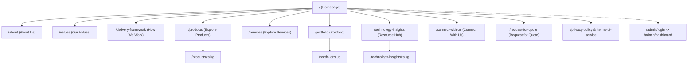

# Route Inventory & Page Architecture

**Project:** Azaroth UI  
**Phase:** Phase 1 — Requirements and Reference Audit  
**Date:** 2026-10-11  

---

## 1. Route Inventory Overview

This document defines the complete route inventory for the Azaroth UI web application, cataloging public marketing pages, conversion flows, resource directories, and administrative foundations mapped from the reference website bundle (`https://azaroth-techhive.com`).

---

## 2. Public Facing Routes

| Route Path | Page Title | Primary Purpose | Key Components | Data / State Dependencies | Auth Required |
| :--- | :--- | :--- | :--- | :--- | :--- |
| `/` | Azaroth Tech-Hive — Enterprise Technology Solutions & Engineering | Flagship homepage establishing enterprise authority, value proposition, metrics, and core conversion paths. | `Header`, `Hero`, `MetricsBanner`, `Pillars`, `FeaturedSolutions`, `ServicesTeaser`, `DeliveryTeaser`, `InsightsTeaser`, `CtaBanner`, `Footer` | Static content, client trust metrics, featured products list. | Public |
| `/about` | About Us — Azaroth Tech-Hive | Deep-dive into company vision, Chennai engineering headquarters, leadership pod, and history. | `Header`, `AboutHero`, `MissionVision`, `LeadershipGrid`, `LocationCard`, `Footer` | Leadership bio data, office metadata. | Public |
| `/values` | Our Values — Azaroth Tech-Hive | Principles governing engineering rigor, security standards, and client partnerships. | `Header`, `ValuesHero`, `ValueGrid`, `ValueCard`, `Footer` | Values data list. | Public |
| `/delivery-framework` | Delivery Framework — 6-Stage Process | Detailed breakdown of the end-to-end milestone-driven delivery process. | `Header`, `FrameworkHero`, `ProcessTimeline`, `MilestoneAccordion`, `SlaNotice`, `Footer` | 6-Stage process schema, milestone checklists. | Public |
| `/how-we-work` | How We Work | Alias route redirecting or rendering the 6-stage Delivery Framework. | `Header`, `DeliveryFrameworkView`, `Footer` | Redirects to `/delivery-framework` or shares layout. | Public |
| `/products` | Explore Products — Enterprise Software Platforms | Filterable directory of proprietary products, platforms, and accelerators. | `Header`, `ProductCatalog`, `ProductFilter`, `ProductCard`, `ProductFeatureDrawer`, `Footer` | Product catalog array, category filter state. | Public |
| `/products/:slug` | [Product Name] — Technical Overview | Dedicated detail page for an enterprise product with architecture specs and RFQ trigger. | `Header`, `ProductDetailHeader`, `TechSpecsTable`, `ArchitectureDiagram`, `InquiryCard`, `Footer` | Route param `:slug`, product detail lookup. | Public |
| `/services` | Explore Services — Engineering, Cloud & AI Systems | Full spectrum of enterprise software engineering, cloud migration, and consulting offerings. | `Header`, `ServicesCatalog`, `ServiceCard`, `SlaMatrix`, `EngagementModelCard`, `Footer` | Service offerings data, SLA comparison table. | Public |
| `/portfolio` | Portfolio & Enterprise Case Studies | Showcase of mission-critical systems delivered across enterprise verticals. | `Header`, `PortfolioGrid`, `CaseStudyCard`, `ClientQuoteCard`, `Footer` | Portfolio items array, industry filters. | Public |
| `/portfolio/:slug` | [Case Study Title] — System Architecture & Impact | Deep-dive case study with business challenge, engineering solution, and impact metrics. | `Header`, `CaseStudyDetail`, `ImpactMetrics`, `ArchitectureBreakdown`, `Footer` | Route param `:slug`, case study lookup. | Public |
| `/technology-insights` | Technology Insights — Resource Hub | Unified resource directory containing whitepapers, technical guides, and thought leadership. | `Header`, `ResourceHubHeader`, `ResourceSearchFilter`, `InsightCardGrid`, `Footer` | Search query state, active category filter, articles list. | Public |
| `/insights` | Technology Insights (Alias) | Alias route linking to the Resource Hub / Technology Insights page. | Alias of `/technology-insights`. | Shares data with `/technology-insights`. | Public |
| `/technology-insights/:slug` | [Insight Title] — Azaroth Insights | Reading-optimized article view with sticky table of contents and code highlights. | `Header`, `ArticleLayout`, `TableOfContents`, `CodeBlock`, `AuthorBio`, `RelatedInsights`, `Footer` | Route param `:slug`, markdown/HTML article parser. | Public |
| `/insights/:slug` | [Insight Title] (Alias) | Alias route linking to article reader view. | Alias of `/technology-insights/:slug`. | Shares article detail lookup. | Public |
| `/connect-with-us` | Connect With Us — Global Head Office & Inquiries | Contact hub featuring office credentials, direct communication channels, and enquiry form. | `Header`, `OfficeDetails`, `ContactForm`, `WhatsAppTrigger`, `MapsEmbed`, `Footer` | Form submission state, input validation state. | Public |
| `/connect` | Connect (Alias) | Direct short URL alias pointing to `/connect-with-us`. | Alias of `/connect-with-us`. | Shares contact form state. | Public |
| `/request-for-quote` | Request for Quote — Structured Scope Wizard | Guided 4-stage wizard collecting project specifications, scope, timelines, and contact details. | `Header`, `RfqWizard`, `StepIndicator`, `ScopeSelector`, `TimelineSelector`, `ContactDetailsForm`, `RfqSuccessModal`, `Footer` | Multi-step wizard state, form validation, RFQ submission endpoint. | Public |
| `/rfq` | RFQ (Alias) | Direct short URL alias pointing to `/request-for-quote`. | Alias of `/request-for-quote`. | Shares RFQ wizard state. | Public |
| `/privacy-policy` | Privacy Policy — Azaroth Tech-Hive | Enterprise data privacy statement and GDPR/statutory compliance documentation. | `Header`, `LegalDocumentView`, `Footer` | Static legal text content. | Public |
| `/terms-of-service` | Terms of Service — Azaroth Tech-Hive | Terms and conditions governing platform usage and commercial service agreements. | `Header`, `LegalDocumentView`, `Footer` | Static terms text content. | Public |
| `*` | 404 — Page Not Found | Clean, on-brand error page guiding users back to Homepage or Resource Hub. | `Header`, `NotFoundCard`, `QuickLinks`, `Footer` | Current invalid path. | Public |

---

## 3. Administrative & Console Routes (Foundation)

| Route Path | Page Title | Purpose | Access Control |
| :--- | :--- | :--- | :--- |
| `/admin/login` | Admin Console Login | Secure administrator authentication portal. | Public (Admin Auth) |
| `/admin/reset-password` | Reset Password | Password reset workflow for administrative operators. | Public (Admin Auth) |
| `/admin/dashboard` | Executive Dashboard | Metrics overview, inbound RFQs, contact enquiries, and content status. | Authenticated (Admin) |
| `/admin/rfqs` | RFQ Management | Review, triage, and export inbound requests for quotes. | Authenticated (Admin) |
| `/admin/enquiries` | Enquiry Management | Inbox for contact form messages and inquiries. | Authenticated (Admin) |
| `/admin/content` | Content & Pages Manager | CMS control panel for editing page copy, pillars, and hero text. | Authenticated (Admin) |
| `/admin/products` | Products Catalog CMS | Admin management for products, technical specs, and features. | Authenticated (Admin) |
| `/admin/services` | Services Catalog CMS | Admin management for service offerings and SLA matrices. | Authenticated (Admin) |
| `/admin/insights` | Insights & Blog CMS | Markdown editor and publishing workflow for articles and whitepapers. | Authenticated (Admin) |
| `/admin/settings` | System Settings | Brand tokens, office addresses, contact emails, and social links config. | Authenticated (Admin) |

---

## 4. Route Navigation & Linking Hierarchy

